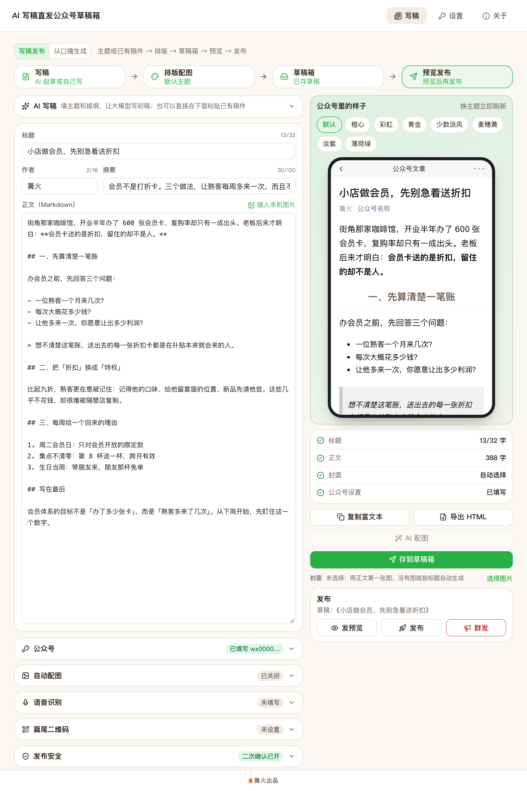

# AI 写稿直发公众号草稿箱

> 篝火出品 · 收录于篝火 App 应用区

AI 写稿、自动配图、排版后存到草稿箱，先预览再发布；也能把自己的口播视频做成图文卡片。全部走公众号官方接口



## 下载

到 [Releases](https://github.com/campfire-code/wechat-draft-publisher/releases/latest) 下载对应安装包：

| 电脑 | 文件 |
|---|---|
| Windows 10 / 11 | `wechat-draft-publisher_版本号_windows-x64-setup.exe` |
| Mac（Apple 芯片） | `wechat-draft-publisher_版本号_mac-arm64.dmg` |
| Mac（Intel 芯片） | `wechat-draft-publisher_版本号_mac-x64.dmg` |

第一次打开：
- **Windows**：如果弹出「Windows 已保护你的电脑」，点「更多信息」→「仍要运行」。
- **Mac**：如果提示「无法验证开发者」，打开「系统设置 → 隐私与安全性」，在下方点「仍要打开」。

## 风险与免责

- **群发会推送给公众号的全部粉丝，发出后无法撤回**，每个公众号的群发次数也有限；「发布」同样对外可见。工具里这两个按钮默认带**二次确认**（在「发布安全」里可以关闭，不建议）。
- 一键流程只做到「存草稿 → 发预览」为止，**不会自动发布或群发**。
- 文章、配图、口播卡片都由 AI 生成，发出前请自己通读，对内容的准确性和合规负责。配图模型、语音识别按各服务商的规则计费，请留意额度。
- 「从口播生成」只用于处理**你自己发布或拍摄的视频**，不要用来搬运他人作品。
- 密钥只保存在本机，使用本工具产生的一切后果由使用者自行承担。

## 怎么用

**第一次使用：按需填设置**（写稿页下方的几个折叠栏，顶部「设置」里是大模型）
1. 顶部「设置」填大模型的接口地址、密钥和模型名（兼容 OpenAI 接口格式，DeepSeek、通义千问、Kimi 等都可以）。不用 AI、只排版的话可以不填。
2. 「公众号」栏填 **AppID** 和 **AppSecret**（在「微信开发者平台 → 扫码登录 → 我的业务 → 你的公众号」里查看，忘记了只能重置），想先看预览的话再填**你自己的微信号**（需要关注了这个公众号）。
3. **IP 白名单**：公众号接口只允许白名单里的 IP 调用。请在同一页面的「API IP 白名单」里加入**你这台电脑当前的公网出口 IP**（调用失败时提示里会写出微信看到的 IP，照着加即可）。本工具**不内置代理**；如果你的出口 IP 经常变化（拨号、手机热点、公司网络），白名单会时不时失效，需要改用固定出口。点「保存并测试连接」显示「连接成功」就说明三项都没问题。
4. 「自动配图」栏（可选）：填图像模型的接口地址、密钥、模型名（兼容 OpenAI 的 `/images/generations`），打开开关。
5. 「语音识别」栏（用「从口播生成」时需要）：填语音识别的接口地址、密钥、模型名（兼容 OpenAI 的 `/audio/transcriptions`）。
6. 「篇尾二维码」栏（可选）：上传你自己的二维码图片，可加一句话，会加在每篇文章末尾。

以上接口都只由你自己填写，工具不内置任何密钥或账号；填写的内容只保存在这台电脑上。

**写稿发布**
1. 展开「AI 写稿」，填主题（没想好就点「给我几个标题」），可选填提纲和参考资料（AI 只用资料里的事实），选风格和篇幅，点「生成文章」。也可以不用 AI，直接把已有稿件粘贴到正文里。
2. 标题最多 32 字、作者 16 字、摘要 120 字，超出时计数变红。正文是 Markdown，点「插入本机图片」可以放图。
3. 右侧实时预览公众号里的样子，8 套主题随时切换。外部链接会自动转成文末脚注。
4. 「AI 配图」：生成封面（裁成横版）和若干张插图，插图放进正文各小节标题下面，图片保存在「下载/AI 写稿直发公众号草稿箱/配图」。
5. 「存到草稿箱」：自动上传正文图片（不是 JPG/PNG 或超过 1MB 的会转成 JPG 并压缩）和封面，新建草稿。封面可手动选；不选时用正文第一张图，再没有就按标题生成。
6. 右下角「发布」：**发预览**（发到你填的微信号，在手机上看真实效果）→ 确认没问题 → **发布**或**群发**（会先弹出确认）。
7. 「一键到预览」：填好主题后一步完成写稿、配图、排版、篇尾二维码、存草稿、发预览。

**从口播生成**
1. 切到「从口播生成」，选**本机视频**（拖进窗口或点选择；音频文件也行），或粘贴**你自己发布的抖音分享链接**并勾选确认。
2. 点「识别并改写成卡片」：提取音频 → 语音转文字 →（可选）大模型校对错别字 → 改写成「标题 + 引导语 + 若干张卡片」。
3. 卡片文字都可以改；右侧预览整套 1080×1440 卡片，有 3 套模板，文字太多的卡片会标红框。
4. 存为**图片消息**（图片消息草稿，首张为封面，最多 20 张）或**图文消息**（卡片依次排进正文），也可以「导出卡片图」。存好后同样用右下角「发布」预览、发布。

**注意**
- 走的是微信公众号官方接口，不模拟登录。未认证的订阅号可能没有草稿、预览、发布等接口权限，会提示「没有调用该接口的权限」。
- 每次存草稿会新增永久图片素材（封面、卡片图），素材库图片上限 10 万张。
- 微信的群发成功后，这份草稿会被微信自动删除；发布和群发提交成功只代表任务已提交，结果以公众号后台为准。

**未核实、以平台为准**
- 按微信号预览要求对方关注了公众号、每日有次数限制（接口文档写 100 次）、仅认证号可调用；预览接口文档没有写明能否直接使用「草稿」的 media_id，群发接口的文档写明可以。本工具直接用草稿的 media_id 预览，如果你的账号提示 media_id 无效，请反馈。
- 图片消息草稿能否用接口群发，文档没有说明，本工具对图片消息只提供「发布」。
- 图片消息的标题官方限制 32 字；手机上显示约 20 字是经验值，未核实。图片消息文字描述的长度官方未写明，工具保守地限制在 600 字节以内。
- 抖音分享页的结构可能随时变化或被拦截，工具未用真实链接联网验证。解析失败时请把视频存到电脑，用「本机视频」。
- 语音识别接口常见的上传上限是 25MB，其他服务商以各自文档为准；本工具把音频转成 16kHz 单声道 WAV（约每分钟 1.9MB），所以超过十几分钟的视频需要先截取。

## 验收用例

没有真实公众号时，带「需公众号」的用例列入待联调清单；其余用例可以直接验证。

| 操作 | 应得到 |
|---|---|
| 首次打开 | 编辑区是示例文章「小店做会员，先别急着送折扣」，右侧显示公众号样式预览，与 `samples/示例导出-默认主题.html` 的样式一致；「发布安全」显示「二次确认已开」 |
| 依次点 8 个主题 | 预览的标题、引用、列表样式随之变化，左侧内容不变 |
| 设置好大模型后，按 `samples/示例写稿要求.txt` 填主题、提纲、参考资料，点「生成文章」 | 30 秒内标题、摘要、正文被替换为新文章；正文有 3～6 个「## 」小标题 |
| 标题改成 33 个字，点「存到草稿箱」 | 计数显示 33/32 并变红，提示「标题超过 32 个字（现在 33 个）」，不发请求 |
| 点「复制富文本」粘贴到公众号编辑器 | 出现带样式的文章，与预览一致 |
| 点「导出 HTML」 | 下载目录的「AI 写稿直发公众号草稿箱」里出现 `标题.html` |
| 「自动配图」未开启时看「AI 配图」按钮 | 按钮是灰的，悬停提示先开启并填好接口 |
| 填好图像模型并开启，点「AI 配图」（需图像模型） | 生成封面和插图，插图出现在各 `##` 小标题下面，图片文件保存在「配图」文件夹；单张失败时提示失败原因，其余照常 |
| 公众号设置里 AppID 填 `wx0000000000000000`、AppSecret 随便填，点「保存并测试连接」 | 提示「AppID 不对，请检查是否填错（注意大小写和多余空格）」 |
| （需公众号）填正确的 AppID / AppSecret，但没加 IP 白名单，点「保存并测试连接」 | 提示「本机公网 IP 不在公众号的 IP 白名单里（微信看到的 IP 是 x.x.x.x）……」 |
| （需公众号）加好白名单，用示例文章点「存到草稿箱」 | 依次显示「正在连接公众号… / 正在上传正文图片… / 正在上传封面… / 正在存入草稿箱…」，提示已存入；后台草稿箱出现这篇文章；右下「发布」栏显示草稿标题 |
| （需公众号）填好预览微信号，点「发预览」 | 提示预览已发出，该微信号收到这篇文章的预览 |
| 点「群发」 | **不会直接发送**，先出现红色确认框，写明标题、「全部粉丝」「无法在这里撤回」；点「取消」什么都不发生 |
| 在「发布安全」关掉二次确认后点「发布」 | 直接提交（需公众号）；重新打开开关后恢复确认 |
| 在「篇尾二维码」选一张图，预览 | 预览文章末尾出现这张图（及你填的一句话）；存草稿时一并上传 |
| 切到「从口播生成」，选 `samples/示例口播稿.txt` 的内容念一遍录成视频（需语音识别、大模型） | 识别出文字，生成约 7 张卡片，标题不超过 20 字；预览里没有红框 |
| 「我的抖音链接」不勾选「这是我自己发布的视频」点开始 | 提示请先确认这是你自己发布的视频，不发请求 |
| 载入 `samples/示例卡片脚本.json` 里的文字（手动抄进卡片）后选「图片消息」存草稿（需公众号） | 草稿箱出现图片消息，首张为标题卡，共 4 张图 |

## 更新内容

见 [CHANGELOG.md](CHANGELOG.md)。0.3.0 的主要变化：新增自动配图、篇尾二维码、预览→发布/群发（默认二次确认）、「从口播生成」，一键流程到预览为止。

## 自己编译

需要 Node.js 22、pnpm、Rust。

```bash
pnpm install
pnpm test          # 单元测试
pnpm tauri dev     # 开发运行
pnpm tauri build   # 打包
```

界面框架在 `src/kit`（所有 campfire-code 工具共用），本工具的逻辑在 `src/tool`。

## 致谢

公众号排版使用 [文颜 wenyan-core](https://github.com/caol64/wenyan-core)（`@wenyan-md/core`，Apache-2.0，与 [caol64/wenyan-mcp](https://github.com/caol64/wenyan-mcp) 同一作者），8 套排版主题来自该项目及其主题作者。公众号接口按微信开发者文档实现。

## 归属

本工具由**篝火**出品，是篝火 App 应用区收录的开源工具之一，由篝火（GitHub 组织 [campfire-code](https://github.com/campfire-code)）维护与更新。全部工具的目录见 [toolkit-hub](https://github.com/campfire-code/toolkit-hub)。

## 许可证

MIT，版权方为篝火（campfire-code）。
